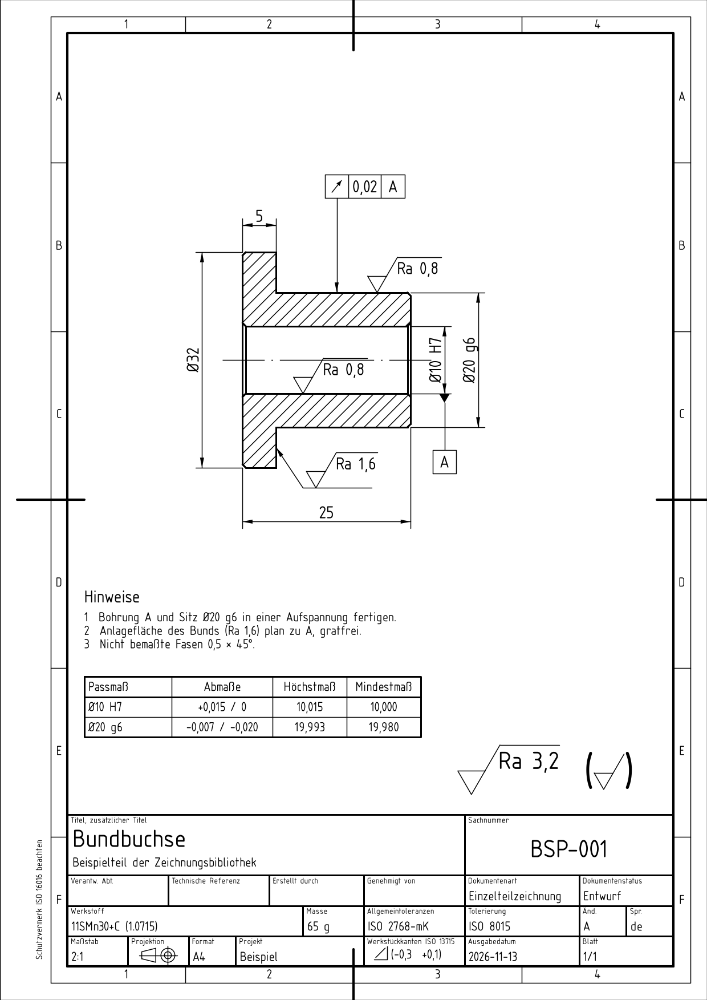
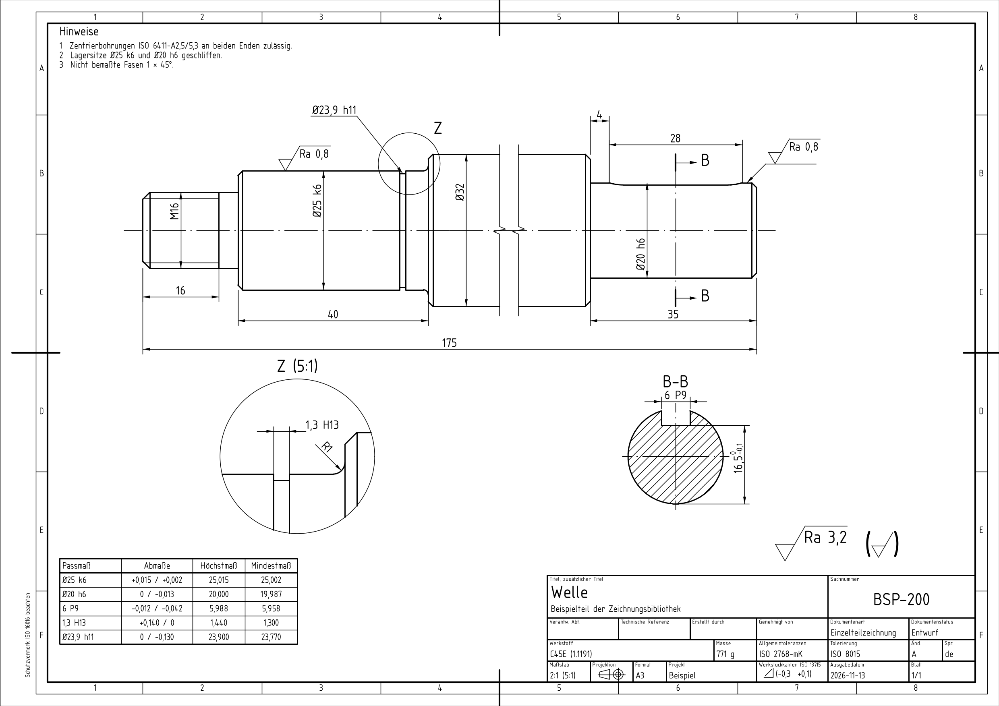
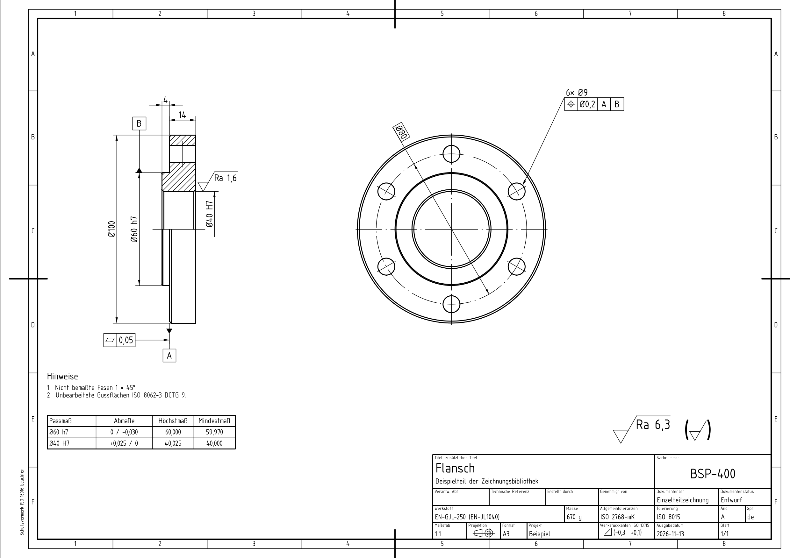
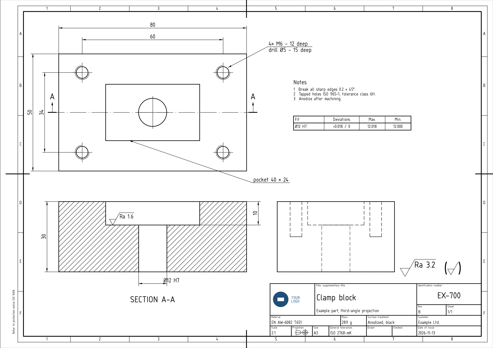

# technical-drawing — ISO technical drawings from code or from a STEP file

Turn a 3D model into a drawing a workshop can manufacture from: views with hidden-line
removal, sections, detail / half / broken views, dimensions with ISO 286 fits, geometrical
tolerances, surface texture, threads, weld symbols, tables, parts list and title block —
as vector **PDF**, **SVG**, **DXF** and PNG. Every sheet is **checked automatically**
before it is written: overlapping texts, text over contours, content outside the frame,
datums that are referenced but not shown, invalid fits, missing title block entries.

It is a Python library (`drawlib`), a command line tool (`step2drawing`) and a
[Claude Code](https://claude.com/claude-code) skill.

<p align="center">
  
  
</p>
<p align="center">
  
  
</p>

## Three ways in

**1. You have a STEP file** — from SolidWorks, Inventor, Fusion, FreeCAD, Onshape, …

```bash
pip install "technical-drawing[dxf] @ git+https://github.com/Emirhan-1111/technical-drawing"
step2drawing part.step
step2drawing part.step --lang en --projection third --units in --dxf
step2drawing part.step --section --material "EN AW-6082 T651" --density 2.7
```

You get three orthographic views placed by the projection method, an isometric view,
hidden lines, centre lines on every cylindrical feature, overall dimensions, a filled title
block with the mass, sheet size and scale chosen automatically, and the check report.
That is a correct *starting* sheet; functional dimensions, fits and tolerances are added in
the PDF/DXF by hand, or in Python on top of `auto_drawing()`.

**2. You write the drawing in Python** — the model is the single source of truth, so a
changed parameter regenerates every view and every dimension:

```python
import drawlib as D

S = D.Sheet("A4", lang="en")                       # "de"/"en", projection="first"/"third"
V = D.View(S, (72, 190), 2.0, *D.VIEWS["front"])   # sheet origin, scale 2:1, direction
V.section([(V.cut(part), 45, 2.5)])                # section through the plane y = 0
S.vdim(V.p(25, -5), V.p(25, 5), 125, "Ø10 H7")
S.datum("A", V.p(30, -5), (0, -1))
S.fcf_leader(S.fcf(120, 215, "runout", "0.02", ["A"]), V.p(14, 10), "bottom")
S.rough(V.p(20, 10), "Ra 0.8")
S.fit_table(25, 96, ["Ø10 H7", "Ø20 g6"])          # limits straight from ISO 286
S.title_block(dict(title="Flanged bush", number="BSP-001", material="11SMn30+C",
                   mass="65 g", scale="2:1"))
S.save("BSP-001.pdf", png="BSP-001.png", dxf="BSP-001.dxf")
```

The [tutorial](https://github.com/Emirhan-1111/technical-drawing/blob/main/docs/TUTORIAL.md) goes from an empty file to that sheet in ten minutes.

**3. You ask Claude** — with the skill installed, "make a manufacturing drawing of this
part" runs the whole workflow: model, interference check, views, annotations, render,
look, fix, deliver.

## Example gallery

Each script in [`examples/`](https://github.com/Emirhan-1111/technical-drawing/tree/main/examples) is a complete, commented sheet — copy the one closest
to your part. All of them pass the sheet check with zero findings.

| Sheet | Shows |
|---|---|
| [`flanged_bush.py`](https://github.com/Emirhan-1111/technical-drawing/blob/main/examples/flanged_bush.py) · [PDF](https://github.com/Emirhan-1111/technical-drawing/blob/main/examples/output/BSP-001.pdf) | Turned part, section, fits, run-out to a datum, surface texture, limits table; `--lang en` |
| [`bearing_bracket.py`](https://github.com/Emirhan-1111/technical-drawing/blob/main/examples/bearing_bracket.py) · [PDF](https://github.com/Emirhan-1111/technical-drawing/blob/main/examples/output/BSP-100.pdf) | Assembly: section with the shaft left uncut, cutting plane, item numbers, parts list, fit-pair table |
| [`stepped_shaft.py`](https://github.com/Emirhan-1111/technical-drawing/blob/main/examples/stepped_shaft.py) · [PDF](https://github.com/Emirhan-1111/technical-drawing/blob/main/examples/output/BSP-200.pdf) | Broken view, external thread, detail view 5:1, removed section through a keyway, concave radius |
| [`flange.py`](https://github.com/Emirhan-1111/technical-drawing/blob/main/examples/flange.py) · [PDF](https://github.com/Emirhan-1111/technical-drawing/blob/main/examples/output/BSP-400.pdf) | Half section with half dimension, pitch circle, position tolerance under a hole callout, flatness |
| [`spur_gear.py`](https://github.com/Emirhan-1111/technical-drawing/blob/main/examples/spur_gear.py) · [PDF](https://github.com/Emirhan-1111/technical-drawing/blob/main/examples/output/BSP-500.pdf) | Gear drawn simplified (ISO 2203), gear data table with span measurement, keyway, total run-out |
| [`weldment.py`](https://github.com/Emirhan-1111/technical-drawing/blob/main/examples/weldment.py) · [PDF](https://github.com/Emirhan-1111/technical-drawing/blob/main/examples/output/BSP-600.pdf) | Welded bracket: fillet welds both sides, process number, ISO 13920 general tolerances |
| [`milled_block.py`](https://github.com/Emirhan-1111/technical-drawing/blob/main/examples/milled_block.py) · [PDF](https://github.com/Emirhan-1111/technical-drawing/blob/main/examples/output/EX-700.pdf) | English, third-angle, tapped holes, company title block from JSON with logo |
| [`from_step.py`](https://github.com/Emirhan-1111/technical-drawing/blob/main/examples/from_step.py) · [PDF](https://github.com/Emirhan-1111/technical-drawing/blob/main/examples/output/BSP-300.pdf) · [EN](https://github.com/Emirhan-1111/technical-drawing/blob/main/examples/output/BSP-300-en.pdf) · [DXF](https://github.com/Emirhan-1111/technical-drawing/blob/main/examples/output/BSP-300-en.dxf) | STEP file → drawing, German first-angle and English third-angle in inches |

## What is covered

| Area | Standard | In the library |
|---|---|---|
| Sheet, frame, grid, title block | ISO 5457, ISO 7200 | A4–A0, portrait/landscape; title block as data (JSON), logo |
| Lines, lettering | ISO 128-20/-24, ISO 3098 | line group 0,5; osifont (see below) |
| Views | ISO 128-30/-34, ISO 5456-2 | first- and third-angle, any direction, isometric, detail, broken |
| Sections | ISO 128-40/-44/-50 | full, half, removed; parts left uncut; thin parts blackened; hatching interrupted around text |
| Dimensions | ISO 129-1 | linear, aligned, angular, radius, diameter, half dimensions, limit deviations, theoretically exact |
| Limits and fits | ISO 286, ISO 2768-1 | tables built in (IT3–IT14, c–s / C–S), limits and fit tables, fits in texts verified |
| Geometrical tolerances | ISO 1101, ISO 5459 | 14 characteristics, feature control frames, datums |
| Surface texture | ISO 21920-1 | on surface, on leader, on extension line, general note |
| Threads | ISO 6410 | side view, section, end view, internal and external |
| Welds | ISO 2553 | fillet, square, V, bevel; arrow/other/both sides; all-around, field weld, process |
| Gears | ISO 2203 | simplified representation + data table |
| Assemblies | ISO 6433, ISO 7573 | item numbers, parts list |
| Output | — | PDF, SVG, PNG; DXF with layers and line types (`ezdxf`) |

Languages: German and English are built in; add another by putting a dict into
`drawlib.TEXTS`. Decimal markers follow the language (`0,02` / `0.02`).

## The sheet check

`Sheet.save()` checks the sheet before writing it and prints what it finds; with a PNG
preview it also writes `<name>_check.png` with every finding framed in red or orange:

```
drawing check BSP-200.pdf: 0 error(s), 2 warning(s)
  warning text "Ø20 h6" is crossed by a part contour  [B5]
  warning text "R1" is crossed by a part contour  [E3]
```

It finds: texts overlapping each other, texts crossed by part contours or other annotation
lines, texts inside the title block, parts list or tables, drawing content outside the
frame or running into the title block, tolerance frames referring to datums that are not
indicated, datums indicated twice, fits that do not exist (`H17`) or are written the wrong
way round (`h7/G6`), an empty material or scale field, scales outside ISO 5455. The grid
reference (`[B5]`) tells you where to look. It does not judge whether your dimensioning is
functionally right — that is still the engineer's part.

## Install

```bash
pip install "technical-drawing[all] @ git+https://github.com/Emirhan-1111/technical-drawing"
```

or clone and `pip install -r requirements.txt`. Python 3.10+. build123d brings
OpenCascade; on most platforms that is a wheel and installs without a compiler.

**Use as a Claude Code skill:** clone into your skills folder —

```bash
git clone https://github.com/Emirhan-1111/technical-drawing ~/.claude/skills/technical-drawing
```

(Windows: `%USERPROFILE%\.claude\skills\technical-drawing`). `SKILL.md` carries the
description Claude matches against; the `references/` files are read on demand.

## The lettering font

ISO 3098 lettering needs a technical font. The library uses
[osifont](https://github.com/hikikomori82/osifont) but does **not** ship it, so this
repository stays under one simple licence. It is found automatically in, in this order:
`$DRAWLIB_FONT`, `scripts/fonts/`, `~/.drawlib/fonts/`, or installed system-wide. Without
it everything still works with DejaVu Sans: geometry, line widths and layout are
identical, only the lettering is then not ISO 3098. The sheet check measures the real
text extents of whichever font is used.

## Repository layout

| Path | What it is |
|---|---|
| `SKILL.md` | The Claude Code skill: workflow, rules, what a good drawing has to achieve |
| `scripts/drawlib.py` | The library |
| `scripts/iso_tolerances.py` | ISO 286 / ISO 2768 tables and functions |
| `scripts/step2drawing.py` | STEP → drawing, command line and `auto_drawing()` |
| `scripts/dxf_export.py` | DXF writer |
| `references/drawlib_api.md` | Every call, its arguments, recipes and pitfalls |
| `references/normen.md` | Standards tables, reference values, drawing checklist |
| `docs/TUTORIAL.md` | From an empty file to a finished sheet |
| `examples/` | The gallery and its rendered output |
| `tests/` | ISO 286 values against the standard, the check, every example |

## What this is not

- Not a CAD system: no native SolidWorks/Inventor drawing files. Editing afterwards
  happens in the DXF, or in the Python script.
- The check catches layout and consistency errors, not engineering errors. Tolerance and
  roughness values are decisions — keep track of which come from a specification and
  which you chose.
- Gears, springs and splines are drawn simplified, as the standards intend; the teeth
  themselves are not modelled.

## Licence

MIT, see [LICENSE](https://github.com/Emirhan-1111/technical-drawing/blob/main/LICENSE). osifont is not part of this repository and has its own
licence (LGPL-3.0 with font exception; embedding it in a PDF is allowed).
